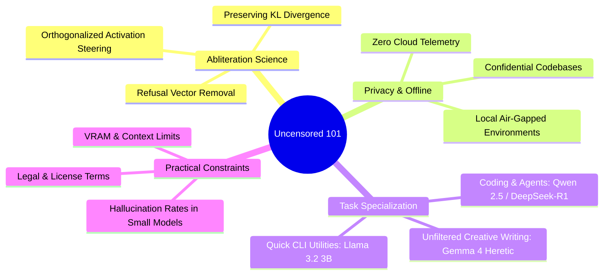

# 🛡️ Running Uncensored AI Locally on Your Own GPU for $0
### Complete Guide: Abliterated Models, Ollama, Claude Code Integration & Hardware Architecture

*Saved Reference & Knowledge Base Document*

---

## 📌 Executive Summary
This guide documents the end-to-end setup for running an abliterated (refusal-free) local LLM on private hardware with zero subscription cost, no external API keys, and complete data privacy.

---

## 🚀 The 4-Step Setup Guide

### Step 1: Install Ollama
Make sure to use a recent build of Ollama that supports the Anthropic API emulation and newer architectures:
```bash
# Linux / macOS / WSL
curl -fsSL https://ollama.com/install.sh | sh

# Windows (Direct Installer / PowerShell)
# Download from https://ollama.com/download/OllamaSetup.exe
```
> [!NOTE]
> Older builds do not emulate the Anthropic `/v1/messages` endpoint and lack support for Gemma 4 architectures.

---

### Step 2: Pull the Abliterated Model
Pull a tested, mathematically validated abliterated model rather than an unverified tag:
```bash
ollama pull igorls/gemma-4-12B-it-heretic-GGUF
```

#### Why This Specific Build?
- **Heretic Abliteration**: Refusals reduced from **99/100 → 0/100**.
- **Preserved Intelligence**: Minimal KL divergence (**0.028**) from the original base model weights, retaining reasoning and syntax capability.
- **Licensing**: Governed by Google's underlying Gemma terms of use (permissible for personal and research applications).

---

### Step 3: Disable Thinking Mode (Critical Optimization)
Gemma 4 is a hybrid thinking model. The abliteration process specifically targets **non-thinking mode**. If thinking mode remains enabled, the reasoning block will consume the token budget, resulting in truncated responses.

#### Interactive CLI:
```bash
ollama run igorls/gemma-4-12B-it-heretic-GGUF
/set nothink
```

#### API Request Payload:
When invoking via HTTP/REST, pass `"think": false`:
```json
{
  "model": "igorls/gemma-4-12B-it-heretic-GGUF",
  "prompt": "Your instruction here...",
  "think": false,
  "stream": false
}
```

---

### Step 4: Connect to Claude Code (Optional Integration)

You can launch directly through Ollama or route standard CLI tools via environment variables:

#### Direct Launch:
```bash
ollama launch claude --model igorls/gemma-4-12B-it-heretic-GGUF
```

#### Manual Environment Routing:
```bash
# Linux / macOS / WSL
export ANTHROPIC_BASE_URL=http://localhost:11434
export ANTHROPIC_AUTH_TOKEN=ollama
claude --model igorls/gemma-4-12B-it-heretic-GGUF

# Windows PowerShell
$env:ANTHROPIC_BASE_URL="http://localhost:11434"
$env:ANTHROPIC_AUTH_TOKEN="ollama"
claude --model igorls/gemma-4-12B-it-heretic-GGUF
```

---

## ⚠️ Critical Gotchas & Limitations

1. **Context Window Expansion Required**:
   - Ollama defaults to **4k context** (`4096` tokens).
   - Agent system prompts (such as Claude Code) often exceed 4k tokens alone, which prevents the model from seeing tool instructions.
   - **Fix**: Launch the Ollama daemon with expanded context:
     ```bash
     # Linux / macOS
     OLLAMA_CONTEXT_LENGTH=32768 ollama serve

     # Windows PowerShell
     $env:OLLAMA_CONTEXT_LENGTH="32768"
     & "C:\Users\kedar\AppData\Local\Programs\Ollama\ollama.exe" serve
     ```
   - *Note: Setting this in a sub-shell does nothing if Ollama is already running as a system service. Restart the service to apply.*

2. **Tool-Calling Maturity**:
   - Gemma 4 tool-calling is still early and can produce malformed function calls or failed edits during autonomous agent tasks.
   - For serious autonomous agent workflows, consider **Qwen 2.5 (7B/14B)** or **GLM-4** architectures.

3. **Hardware Baseline for 12B Q4**:
   - **VRAM**: 8 GB to 12 GB dedicated GPU memory for Q4 quantization.
   - **Storage**: ~8 GB disk for Q4; ~13 GB for Q8.
   - Extended context (32k) requires additional VRAM beyond the 8GB floor.

---

## ⚖️ Honest Engineering Take

- **Abliterated ≠ Smarter**: Abliteration removes refusal vectors; it does not add reasoning capabilities or coding depth. A 12B model remains a 12B parameter model.
- **Privacy is the Real Win**: You control the weights. Prompts and source code never leave your local hardware or local network.
- **Safety**: Personal responsibility remains with the practitioner for lawful and ethical deployment.

---

## 💻 Hardware Sizing & Compatibility Analysis

### Your Local System Diagnostics:
- **GPU**: NVIDIA GeForce GTX 1650 (**4.00 GB VRAM**)
- **RAM**: 7.34 GB Total (**~0.8 GB Available Free**)
- **Disk**: 44 GB Free Space

### Tailored Deployment Recommendations:

| Target Model Size | Local PC Execution (GTX 1650 4GB) | Google Colab Execution (Free T4 16GB GPU) | Recommendation |
| :--- | :--- | :--- | :--- |
| **3B Models** (`llama3.2:3b`, `qwen2.5:3b`) | **100% Fits in 4GB VRAM** • Fast (15–20 tok/s) | Runs instantly | **Optimal for Local PC** |
| **7B–8B Q4 Models** (~4.5 GB) | Partial GPU offload + System RAM (slower) | Runs 100% in VRAM at high speed | **Colab or Light Local Use** |
| **12B–14B Q4 Models** (~8.0 GB, e.g. Gemma-4-12B) | Exceeds 4GB VRAM; requires ~8GB RAM (will cause OOM on this PC) | **100% Fits in Colab 16GB VRAM** | **Run in Google Colab** |

> [!TIP]
> To run 12B+ abliterated models without spending money on new GPU hardware, spin them up inside the **Divya Mangalam Google Colab Engine**, which provides a **16GB Tesla T4 GPU for $0** with zero local disk or RAM footprint!

---

## 📋 "Uncensored 101" Article Outline & Model Taxonomy

For your upcoming article and personal model stack, here is the structured blueprint:



### Curated Uncensored / Abliterated Models by Task:
1. **Agentic & Tool Calling**: `qwen2.5-coder:7b-instruct-abliterated` (top-tier function calling).
2. **Deep Reasoning & Logic**: `deepseek-r1-distill-qwen-8b` / `14b`.
3. **General Instruction & Refusal-Free Writing**: `igorls/gemma-4-12B-it-heretic-GGUF`.
4. **Lightweight Edge / Laptop (Fits 4GB VRAM)**: `llama-3.2-3b-abliterated` or `qwen2.5:3b`.
